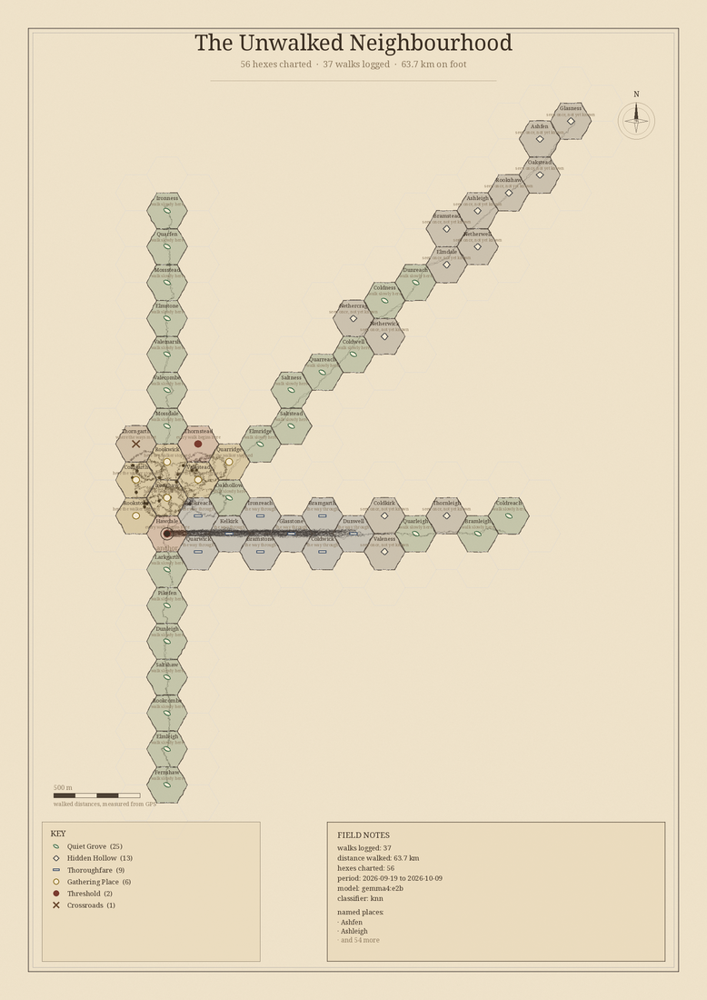
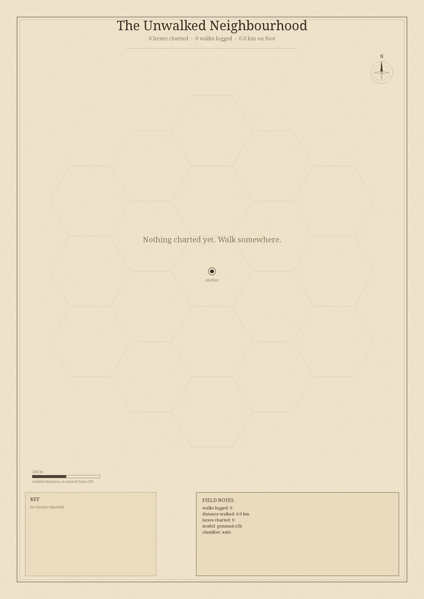
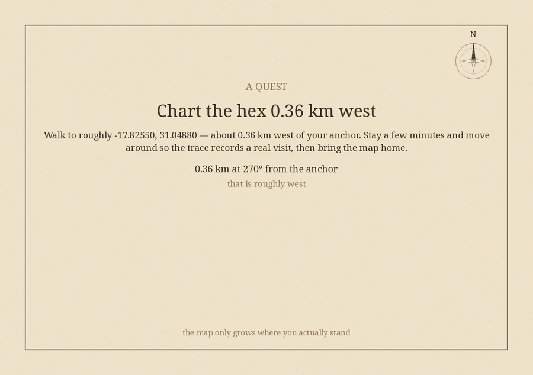

# TerraTale

**A hand-drawn treasure map of your neighbourhood that is blank until you walk it.**
Every real walk inks in new hexes, and a local Gemma writes the legends for the
places your GPS trace actually visited. Print it weekly.

`Touch Grass` entry for the [Hacktoberfest Open-Source AI Challenge, Week 1](https://dev.to/challenges/hf26).



| The sheet you start with | Where to go next |
|---|---|
|  |  |

---

## The idea

A blank sheet of parchment with one hex charted: wherever you live. You export
the walk you already took, run one command, and the map grows where your feet
went and nowhere else. Uncharted hexes are dashed ghosts at the edge of the
charted ground — you can see exactly which direction is still unknown.

Two open models do the work, and neither is decoration:

| Job | Model | Why it has to be this one |
|---|---|---|
| Decide *what kind of place* each hex is | **TabPFN** | The dataset is a few dozen rows that belong to one person. TabPFN does few-shot tabular classification with no training run, so the primer ships in the box and your own labels bend it immediately. |
| Write the name and the legend | **Gemma**, locally via Ollama | A map of everywhere you walk is a map of where you live. It stays on your disk. |

## Why open models are load-bearing here, not decorative

**Your location history never leaves the machine.** Not "we don't sell it" —
there is no server to send it to. TerraTale has no account, no sync, no
telemetry, and no network call in the map pipeline at all. For a project whose
entire input is *the shape of your daily life*, a cloud API would mean handing a
third party a movement record that is trivially de-anonymisable. This is the
case where local inference is not a cost optimisation, it is the only
defensible design.

**It works with the network off.** The whole pipeline — GPX parsing, hex grid,
feature extraction, classification, map rendering, PDF output — runs offline.
The map is a file on disk you own. The only thing that needs Ollama is the
prose, and if Ollama is not running the map still renders (see *Honesty* below).

**The taxonomy is yours to change.** Place archetypes are not baked into
weights. You label a hex, that label joins the support set, and every other
prediction on the map shifts. `terratale label 2:-1 gathering_place` is a
one-line intervention that would be a fine-tuning run against a closed model.

**Costs nothing to run.** No tokens, no API key, no per-walk bill. A weekly
print ritual should not have a meter running on it.

## How it works

```
 GPX traces ──▶ hex grid ──▶ 16-feature table ──▶ TabPFN ──▶ archetype
                                                              │
                            printed map (SVG/PNG/PDF) ◀── Gemma (Ollama)
                                                              │
                                                        name + legend
```

1. **Import** — `terratale add *.gpx` reads any phone fitness export.
2. **Grid** — the neighbourhood is tiled with flat-top hexes (default 120 m).
   A hex has one neighbourhood radius in every direction, so "did you actually
   get there" means the same thing whichever way the street runs.
3. **Features** — each hex becomes a row of 16 measured quantities: visits,
   distinct days, dwell, median speed, path length, straightness, turn rate,
   distance from home, hour-of-day (circular mean and spread), weekend and
   after-dark fractions, climb, revisit span.
4. **Evidence gate** — a hex is only charted once real walking happened inside
   it. Clipping the corner of a hex on a bus does not ink it in.
5. **TabPFN** classifies each charted hex into a place archetype, using a
   portable primer plus any labels you have given.
6. **Gemma** writes the name, a two-or-three sentence legend grounded in the
   numbers from that specific hex, and a short inscription.
7. **Render** — a parchment map with a cartouche, key, compass and scale bar,
   written as SVG, PNG *and* a real-sized PDF.

## Install

```bash
git clone <this repo> && cd terratale
python3 -m venv .venv && . .venv/bin/activate
pip install -e .

# The real classifier (needs torch; CPU is fine, the dataset is tiny)
pip install -e '.[tabpfn]'

# The legend writer
ollama pull gemma4:e2b      # or gemma3:4b, or any Gemma you have room for
```

Check what your machine can do:

```bash
terratale doctor
```

## Use

```bash
# 1. Anchor the map where you live
terratale init --lat -17.8255 --lon 31.0522 --name "The Unwalked Neighbourhood"

# 2. Import the walk you already took (export GPX from any fitness app)
terratale add ~/Downloads/morning-walk.gpx

# 3. Classify the new hexes and write their legends
terratale reveal

# 4. Print it
terratale map --page a3 --out map/

# 5. Find out where to go next
terratale quest --card
```

No GPS data and just want to see it work:

```bash
terratale demo --days 14        # generates its own walks, marked as synthetic
```

### Teach the map what you know

```bash
terratale label 2:-1 gathering_place   # that hex is my bench
terratale reveal                       # re-classify with your label in the support set
```

Every label joins the TabPFN support set beside the built-in primer.

### Commands

| Command | What it does |
|---|---|
| `init` | Set the anchor point and hex size |
| `add <gpx...>` | Import traces into the atlas |
| `reveal` | Classify hexes, write legends, grow the ones you revisited |
| `map` | Render SVG, PNG and PDF, plus a gazetteer |
| `quest [--card]` | Suggest the next uncharted hex and print a card |
| `label <hex> <archetype>` | Teach the classifier |
| `gazetteer` | Print the written legends |
| `doctor` | Report what this machine can actually run |
| `demo` | Full pipeline on generated walks |

## Two things that were measurably wrong

Both of these are guarded by tests, because both are silent when they break.

**Raw GPS distance is fiction.** Summing a 1 Hz trace measures the receiver's
wander as much as the walk. On a synthetic 2.0 km walk with 3.2 m of noise per
fix, the raw sum reads **8.1 km** — four times the truth. Averaging position
over a short window and resampling on distance brings it back to 2.04 km. The
pipeline measures distance on the smoothed track, so the "km on foot" in the
cartouche is a real number.

**Standing at a hex boundary counts as one visit, not eighty.** GPS noise alone
flips the assignment across a hex edge many times a minute. Excursions shorter
than 25 seconds that return to where they came from are collapsed back into the
stay they interrupted.

Both were found by building the thing and looking at the numbers it produced.

## Honesty about what wrote your text

A legend is only ever drawn from measurements taken in that hex, and every
record carries the backend that wrote it. If Ollama is unreachable, TerraTale
falls back to a deterministic template composer and **says so**, in the CLI, in
`doctor`, and in the `author` field of every entry — because a map full of
confident prose that a language model did not write is worse than no map.

The reference classifier is a k-NN over the same support set. It exists so the
pipeline is testable and offline-safe on a machine without torch. TabPFN is the
intended backend and `reveal` tells you which one ran.

## Tests

```bash
PYTHONPATH=src python3 -m unittest discover -s tests -t .
```

36 tests, standard library only, no network. They cover hex round-tripping,
GPX parsing with and without timestamps, the two bugs above, primer column
alignment, label propagation into the support set, legend validation, atlas
round-tripping, all three render backends, and quest targeting.

## Repository layout

```
src/terratale/
  geo.py           haversine, projection, GPX parsing
  grid.py          flat-top hex lattice, axial coordinates
  features.py      GPS cleaning, per-hex tabular features, evidence gate
  archetypes.py    place archetypes, TabPFN backend, k-NN reference
  legend.py        Gemma via Ollama, validation, offline fallback
  cartography.py   map sheet layout, key, cartouche, gazetteer, quest card
  render.py        SVG / PNG / PDF backends over one draw list
  quest.py         next-destination scoring
  state.py         the atlas on disk
  synth.py         synthetic walks for demos and tests
  cli.py           the commands
```

## Licence

MIT. See [LICENSE](LICENSE).
